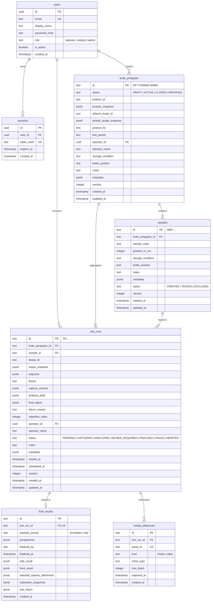

# API AND DATABASE — Fastify Server, PostgreSQL Schema & Drizzle ORM

```text
Status: Current Handover Reference
Last verified against: 29ad46a
Repository: C:\Users\user\Nata\Project\Spray-paragon\website
GitHub: RahmatHadinata23758051/Spray-Website
```

This document provides the complete technical specification of the backend REST API server (`apps/api`), session authentication mechanisms, and the PostgreSQL relational schema managed via Drizzle ORM.

---

## 1. Backend Server Overview

The backend service is located in `apps/api/` and built on **Fastify 5** with TypeScript.

### Key Architectural Characteristics
- **Ultra-low latency**: Fastify's schema-based serialization provides rapid request/response throughput.
- **Strict typing**: Shared domain types (`@spray-paragon/domain`) and validation contracts (`@spray-paragon/contracts`) are shared directly with the frontend.
- **Production security plugins**:
  - `@fastify/cookie`: Encrypted, signed session cookies.
  - `@fastify/rate-limit`: Brute-force protection (configured to 100 requests per minute).
  - Custom Request ID tracking (`genReqId: () => req-...`).

---

## 2. Authentication & Session Security

Authentication is stateful, cookie-backed, and strictly adheres to modern enterprise security standards:

```mermaid
sequenceDiagram
    autonumber
    actor Op as Operator / Browser
    participant API as Fastify (/auth)
    participant DB as PostgreSQL (users, sessions)

    Op->>API: POST /auth/login { email, password }
    API->>DB: Query user by email
    DB-->>API: Return password_hash
    API->>API: argon2.verify(password_hash, password)
    alt Valid Credentials
        API->>API: Generate random token (32 bytes base64url)
        API->>API: SHA-256 hash the token
        API->>DB: INSERT session (user_id, token_hash, expires_at +8h)
        API-->>Op: Set-Cookie: spraybot_session=<token>; HttpOnly; SameSite=Lax; Path=/
        API-->>Op: 200 OK { user: { id, email, displayName, role } }
    else Invalid Credentials
        API-->>Op: 401 Unauthorized
    end
```

### Security Details
1. **Password Hashing**: Uses **Argon2id** (`argon2`), offering maximum resistance to GPU/ASIC cracking.
2. **Session Token Isolation**: The plain session token is sent **only** to the browser in an `HttpOnly` cookie. The PostgreSQL database stores only the **SHA-256 hash** of the token. A database leak cannot compromise active sessions.
3. **Cookie Configuration**:
   - `httpOnly: true`: Inaccessible to client-side JavaScript (mitigating XSS token theft).
   - `sameSite: 'lax'`: Protects against Cross-Site Request Forgery (CSRF).
   - `maxAge: 28800`: 8 hours (typical laboratory shift).
4. **Roles**:
   - `operator`: Can create and execute test studies, record measurements, and finalize runs.
   - `analyst`: Can review finalized runs, compare studies, and export laboratory reports.
   - `admin`: Full system access, including user management and system settings.

---

## 3. Complete REST API Reference

### A. Health & Diagnostics
| Method | Endpoint | Auth | Description |
|--------|----------|------|-------------|
| `GET` | `/health` | Public | System health check, service mode, and server timestamp. |

### B. Authentication Routes (`/auth`)
| Method | Endpoint | Auth | Request Body | Response Payload |
|--------|----------|------|--------------|------------------|
| `POST` | `/auth/login` | Public | `{ email, password }` | Sets session cookie; returns user profile. |
| `POST` | `/auth/logout` | Session | None | Clears cookie; purges session from database. |
| `GET` | `/auth/session` | Session | None | Returns active user profile `{ id, email, displayName, role }`. |

### C. Kode Pengujian CRUD & Synchronization (`/api/kode-pengujian`)
| Method | Endpoint | Auth | Purpose |
|--------|----------|------|---------|
| `GET` | `/api/kode-pengujian` | Required | List all study aggregates (filtered by operator unless Admin). |
| `POST` | `/api/kode-pengujian` | Required | Create a new study context (`CreateKodePengujianRequestSchema`). |
| `GET` | `/api/kode-pengujian/:id` | Required | Retrieve a complete study aggregate with all samples and test runs. |
| `PATCH` | `/api/kode-pengujian/:id` | Required | Update study metadata with optimistic locking (`version` check). |
| `POST` | `/api/kode-pengujian/:kpId/samples` | Required | Register a new physical `Sample` bottle under the study. |
| `PATCH` | `/api/kode-pengujian/:kpId/samples/:sampleId` | Required | Update sample metadata or packaging device configuration. |
| `POST` | `/api/kode-pengujian/:kpId/test-runs` | Required | Create a new `TestRun` execution trial on a sample. |
| `PATCH` | `/api/kode-pengujian/:kpId/test-runs/:runId` | Required | Update setpoints, execution measurements, or analysis drafts. |
| `POST` | `/api/kode-pengujian/:id/sync` | Required | **Bulk Sync**: Accepts `RemoteSyncPayload` (metadata + media manifest). |

### D. Model Testing Sandbox (`/api/model-testing`)
| Method | Endpoint | Auth | Payload / Limit | Description |
|--------|----------|------|-----------------|-------------|
| `GET` | `/api/model-testing/model-status` | Public | None | Returns status of local PyTorch environment & weights. |
| `POST` | `/api/model-testing/infer-frame` | Public | `{ frameIndex, timestampMs, imageBase64 }`<br/>*(Max 25 MB)* | Spawns Python inference subprocess to compute plume mask. |

---

## 4. PostgreSQL Relational Schema & Drizzle ORM

The schema is defined in `apps/api/src/data/postgres/schema.ts`:



---

## 5. The Relational + JSONB Hybrid Strategy

Spraybot adopts a hybrid relational design:

1. **Relational Columns for Querying & Constraints**:
   - Primary and Foreign Keys (`id`, `kode_pengujian_id`, `sample_id`, `operator_id`).
   - Query filters and sort fields (`status`, `product_id`, `product_lot`, `created_at`, `updated_at`).
   - Optimistic concurrency control (`version`).
   - Covered by explicit B-tree indexes (`kp_operator_idx`, `kp_status_idx`, `sample_kp_idx`, `test_run_sample_idx`).

2. **JSONB Columns for Complex Polymorphic Payloads**:
   - `product_snapshot` & `recipe_snapshot`: Guarantees immutability. If a master product recipe changes later, historical tests retain the exact snapshot of values used during test execution.
   - `setpoints`: Encapsulates machine configuration (force, stroke, duration, force mode).
   - `capture_session` & `analysis_draft`: Captures multi-moment frame metadata and candidate contours without requiring dozen-table normalization.
   - `final_report`: Stores the authoritative, immutable finalized report JSON.
