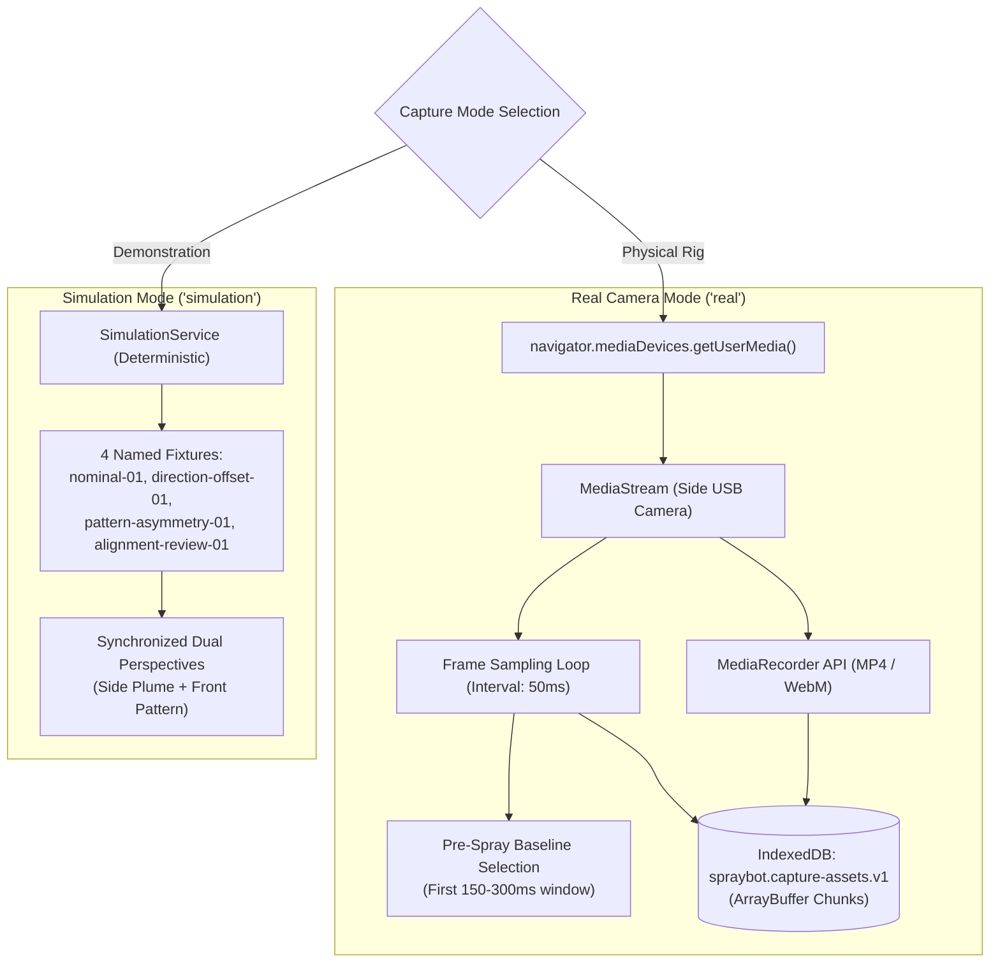
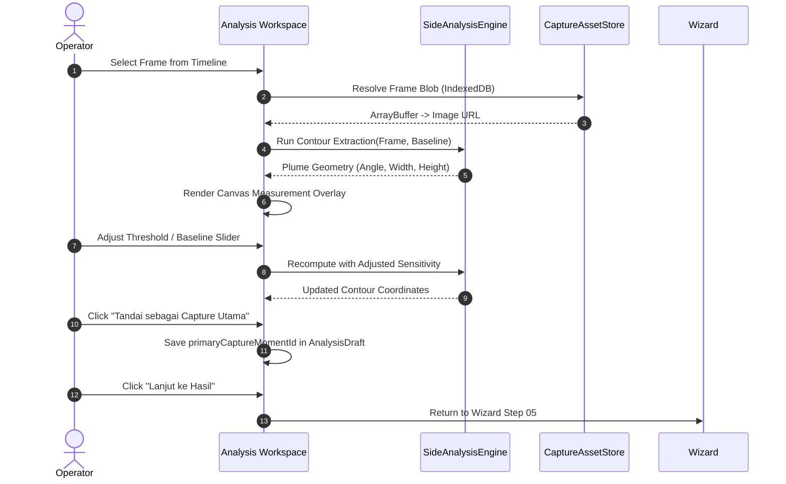

# CAPTURE AND ANALYSIS — Camera Pipelines, Storage & CV Boundaries

```text
Status: Current Handover Reference
Last verified against: 29ad46a
Repository: C:\Users\user\Nata\Project\Spray-paragon\website
GitHub: RahmatHadinata23758051/Spray-Website
```

This document specifies the camera ingestion pipelines, high-volume client-side binary storage, computer vision boundaries, and the distinction between real physical camera capture and deterministic simulation.

---

## 1. Capture Modes: Real vs. Simulation

Spraybot supports two distinct capture modes to accommodate both physical laboratory testing and hardware-free demonstration:



### A. Real Camera Capture Mode (`real`)
Used when an operator connects a physical camera (USB/UVC or high-speed industrial camera via video capture card) to the browser workstation:
- **Constraints**: Enforced via `getSideCameraConstraints()`:
  - Resolution: 1920×1080 (fallback to 1280×720).
  - Target Frame Rate: 60 FPS (minimum 30 FPS).
- **Frame Extraction**: During active spraying, an offscreen HTML5 `CanvasRenderingContext2D` extracts JPEG frames at fixed intervals (typically 50ms) and generates unique `assetId` values (`AST-FRAME-...`).
- **Video Recording**: Simultaneously records an MP4/WebM video stream using `MediaRecorder`, saving the full burst to IndexedDB (`AST-VID-...`).
- **Pre-Spray Baseline Window (`realSideBaseline`)**:
  - The software captures pre-spray ambient frames (e.g., initial 150–300 ms before plume emergence).
  - Used for background subtraction to eliminate lighting anomalies, reflections, and laboratory background fixtures.
  - Supports both automatic detection and operator-selected manual time ranges.

### B. Simulation Mode (`simulation`)
Used when machine hardware is offline or during software demonstrations:
- **Deterministic Fixtures**: Powered by `SimulationService`. Employs 4 static laboratory scenarios:
  1. `nominal-01`: Ideal symmetric plume and circular spray pattern.
  2. `direction-offset-01`: Plume angled $8^\circ$ off-center due to nozzle orifice defect.
  3. `pattern-asymmetry-01`: Front pattern exhibiting heavy droplet clumping and low ellipticity.
  4. `alignment-review-01`: Irregular plume boundary requiring manual operator baseline adjustment.
- **Strict Invariant**: No `Math.random()` is used for stakeholder-facing measurements. Frame coordinates, contour points, and metric numbers are 100% reproducible.

---

## 2. Camera Perspectives & Hardware Reality

A critical hardware fact governs the codebase:

| Camera Perspective | Physical Hardware Existence | Simulation Existence | Analytical Metrics Extracted |
|--------------------|----------------------------|----------------------|------------------------------|
| **Side Camera** (Plume Geometry) | **EXISTS** (Standard USB/Industrial camera facing spray profile) | **EXISTS** (Full fixture set) | - Plume Angle ($^\circ$)<br/>- Plume Width (mm)<br/>- Spray Height (mm)<br/>- Plume Length (mm) |
| **Front Camera** (Spray Pattern) | **DOES NOT EXIST** (Hardware rig lacks front optical mount) | **EXISTS** (Dual-camera simulation fixture) | - Pattern Area ($\text{mm}^2$)<br/>- Ellipticity Ratio<br/>- Center Offset (mm) |

> [!WARNING]
> Because physical hardware only possesses a **Side camera**, real capture workflows strictly execute **Side Plume Analysis**. The Front camera is never faked or fabricated during real captures.

---

## 3. High-Volume IndexedDB Binary Storage Architecture

Storing hundreds of megabytes of video chunks and high-resolution JPEG frames in browser memory or LocalStorage leads to browser crashes and memory exhaustion. 

Spraybot isolates all binary data in **IndexedDB**:

```text
Database Name:    spraybot.capture-assets.v1
Database Version: 2
Object Store:     assets
Key Path:         assetId
Indexes:          batchId, testRunKey
```

### Binary Serialization Protocol
```typescript
type StoredCaptureAsset = {
  assetId: string;       // e.g. "AST-FRAME-KP-261118-0001-SMP-001-TR-001-F04"
  batchId?: string;
  testRunKey?: string;   // e.g. "KP-261118-0001/SMP-001/TR-001"
  type: string;          // e.g. "image/jpeg" or "video/webm"
  kind: 'frame' | 'video';
  data: ArrayBuffer;     // Raw byte payload
};
```

1. **ArrayBuffer Storage**: Browser implementations of structured cloning for `Blob` instances vary and have historical bugs. Spraybot converts all blobs to pure `ArrayBuffer` bytes before writing to IndexedDB.
2. **Scoping & Deletion**: When an operator re-takes a capture (`handleRetakeCapture`), `captureAssetStore.deleteScope({ kind: 'testRun', kpId, sampleId, runId })` purges only the orphaned assets belonging to that specific test run.
3. **Database Protection**: Binary assets are resolved locally into object URLs (`URL.createObjectURL(blob)`). They are **never** synced to PostgreSQL tables or included in JSON sync aggregates.

---

## 4. Computer Vision Analysis & Operator Review

Analysis occurs in `TestRunAnalysisPage.tsx`, which dynamically mounts either:
- `TestRunRealSideAnalysisWorkspace.tsx` (for real captures), or
- `TestRunSimulationAnalysisWorkspace.tsx` (for simulations).



### Analysis Draft Requirements
For a test run to be valid for finalization:
1. **Primary Capture Moment (`primaryCaptureMomentId`)**: The operator must explicitly nominate one frame representing the fully-developed steady-state spray plume.
2. **Supporting Captures (`supportingCaptureMomentIds`)**: The operator may select 1–3 additional frames capturing plume onset or collapse.
3. **Measurement Adjustments**: If the background lighting creates noise, the operator can manually slide the threshold boundary or adjust measurement anchor points on the canvas overlay.

---

## 5. Side CV Architecture & The Model Testing Sandbox

Spraybot separates stable operational analysis from experimental AI research:

### A. Operational Analysis Engine (`SideAnalysisEngine`)
Currently implemented using high-performance HTML5 Canvas pixel manipulation:
- Extracts luminosity contrast between active spray frames and baseline frames.
- Applies Sobel edge filtering and morphological closing.
- Computes plume envelope vertices, finding the nozzle origin, spray tip, and angular boundaries.

### B. Model Testing Sandbox (`/uji-model`)
A dedicated research laboratory screen where Packaging engineers evaluate new deep learning segmentation models (e.g. YOLOv8-seg):
- **Model Location**: `models/segmentation/spraybot_seg_video_finetuned.pt`
- **Inference Script**: `models/segmentation/infer.py`
- **Execution**: The Fastify backend (`apps/api/src/presentation/routes/modelRunner.ts`) spawns a Python subprocess:
  ```bash
  python infer.py --weights spraybot_seg_video_finetuned.pt --frame-base64 <data>
  ```
- **Safety**: The sandbox operates on uploaded test videos (MP4/MOV) completely isolated from production `KodePengujian` records, allowing R&D to benchmark AI precision safely.
