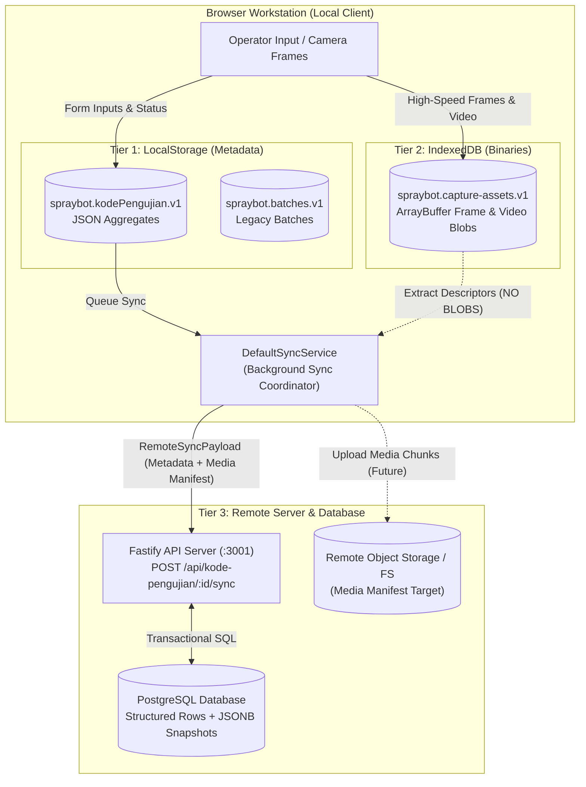
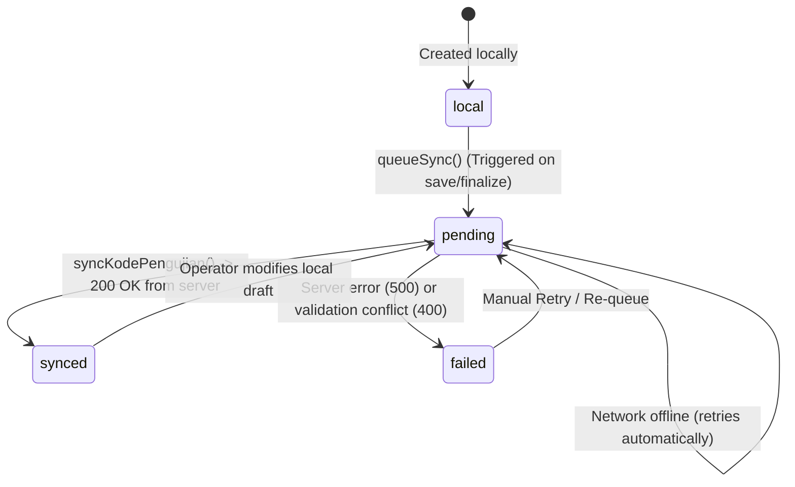

# DATA PERSISTENCE AND SYNC — Hybrid Local-First & Remote Synchronization

```text
Status: Current Handover Reference
Last verified against: 29ad46a
Repository: C:\Users\user\Nata\Project\Spray-paragon\website
GitHub: RahmatHadinata23758051/Spray-Website
```

This document details the hybrid local-first persistence architecture, client-side binary storage strategies, and the background synchronization protocol connecting browser clients to the central PostgreSQL database.

---

## 1. Architectural Philosophy: Why Local-First?

Laboratory environments in manufacturing plants and testing facilities often experience intermittent Wi-Fi, high RF interference from industrial machinery, or air-gapped workstations. 

If a laboratory testing application relies on synchronous HTTP requests to a remote database during physical test execution:
- A 2-second Wi-Fi drop during a high-speed spray burst will drop frame packets.
- An offline server will prevent operators from logging test measurements.
- Network latency creates sluggish UI feedback during wizard step progression.

**Spraybot is architected as an offline-first system.** All test setup, machine configuration, high-speed camera capture, computer vision analysis, and result finalization execute entirely against local browser storage. Synchronization with PostgreSQL is an asynchronous background process that operates opportunistically without blocking the operator.

---

## 2. The Three Storage Tiers



### Tier 1: LocalStorage (JSON Metadata)
- **Primary Key**: `spraybot.kodePengujian.v1`
- **Stored Data**: Full JSON serialization of all `KodePengujian` aggregates, including child `Sample[]` and `TestRun[]` entities, setpoints, physical measurements, and analysis drafts.
- **Characteristics**: Synchronous, instantaneous reads and writes, zero latency, retained across browser restarts.
- **Legacy Compatibility**: `spraybot.batches.v1` is automatically read and converted into the `KodePengujian` format on the fly via `adaptBatchToKodePengujian`.

### Tier 2: IndexedDB (High-Volume Media Binaries)
- **Database Name**: `spraybot.capture-assets.v1` (Version 2)
- **Object Store**: `assets` (Key: `assetId`)
- **Stored Data**: Raw binary data of JPEG frames and MP4/WebM recordings stored as pure `ArrayBuffer` bytes.
- **Characteristics**: Asynchronous, transactional, high storage capacity (typically 20% to 60% of available disk space, tens of gigabytes).

### Tier 3: PostgreSQL (Central Relational Database)
- **Managed Via**: Drizzle ORM running on the Fastify backend.
- **Stored Data**: Long-term enterprise records, multi-user collaboration, finalized reports, and system audit logs.
- **Binary Isolation Rule**: Raw image and video binaries are **NEVER** stored in PostgreSQL database columns. PostgreSQL receives only metadata, structured results, and the `media_references` manifest.

---

## 3. Synchronization Lifecycle State Machine

Every `KodePengujian` entity maintains a `sync` property tracking its synchronization status:

```typescript
export type SyncState = 'local' | 'pending' | 'synced' | 'failed';

export interface SyncMetadata {
  status: SyncState;
  localUpdatedAt: string;
  serverUpdatedAt?: string;
  lastSyncError?: string;
  retryCount?: number;
}
```



### Sync States:
- **`local`**: Created on the local machine; has not yet been queued for remote upload.
- **`pending`**: Queued for synchronization. The background worker attempts transmission as soon as network connectivity is confirmed.
- **`synced`**: Successfully uploaded and acknowledged by the Fastify backend. `serverUpdatedAt` matches or exceeds `localUpdatedAt`.
- **`failed`**: Transmission rejected due to a business rule conflict, validation failure, or unrecoverable error. The failure reason is logged in `lastSyncError`.

---

## 4. The Media Manifest Protocol (Binary Decoupling)

A major failure pattern in naive web apps is attempting to base64-encode megabytes of camera video into JSON sync payloads. This leads to HTTP gateway timeouts (413 Payload Too Large) and database table bloat.

Spraybot solves this using a **Media Manifest**:

```typescript
export interface RemoteMediaDescriptor {
  assetId: string;
  kind: 'frame' | 'video';
  mimeType: string;
  sizeBytes: number;
  scope: {
    kind: 'testRun';
    kpId: string;
    sampleId: string;
    runId: string;
  };
  localCreatedAt: string;
}

export interface RemoteSyncPayload {
  kp: KodePengujianPayload;
  mediaManifest: RemoteMediaDescriptor[];
  pushedAt: string;
}
```

### How the Sync Coordinator Operates (`DefaultSyncService`)
1. **Inspects Test Runs**: Loops through all `testRuns` in the `KodePengujian` and gathers references to all captured frames and recorded videos.
2. **Generates Descriptors**: Constructs lightweight `RemoteMediaDescriptor` objects capturing `assetId`, `sizeBytes`, `mimeType`, and timestamps. **Raw bytes are omitted.**
3. **Pushes Aggregate**: Sends the JSON aggregate (`kp`) and the `mediaManifest` in a single HTTP request to `POST /api/kode-pengujian/:id/sync`.
4. **Registers Remote Media**: The server records the descriptors into the `media_references` database table and returns optional presigned upload URLs.
5. **Local Acknowledgment**: Upon receiving `{ success: true, serverUpdatedAt }`, the client updates the local entity to `status: 'synced'`.

---

## 5. Optimistic Locking & Conflict Resolution

To prevent an operator from inadvertently overwriting changes made on another workstation:
- Both `KodePengujian` and `TestRun` records feature an integer `version` field (starting at `1`).
- When sending a `PATCH` or sync payload, the client supplies the current `version`.
- The Fastify backend compares the incoming `version` with the PostgreSQL record.
- If the server has a newer version, the request is rejected with `409 Conflict` (`VERSION_CONFLICT`), returning the server's current state so the client can present a resolution prompt without data loss.
