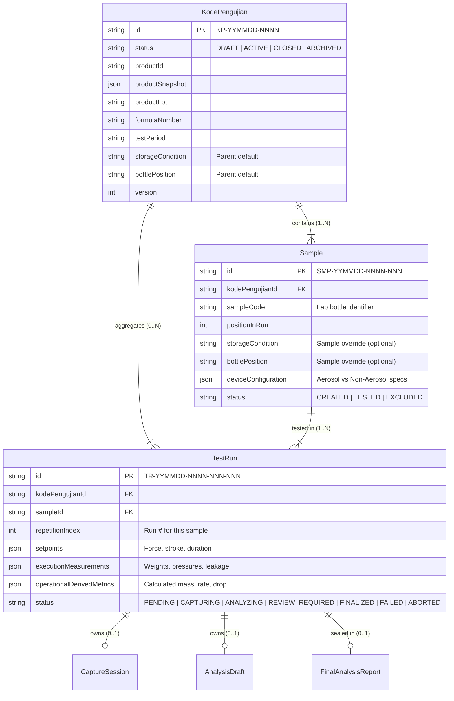

# DOMAIN MODEL — Canonical Entities, Hierarchies & Invariants

```text
Status: Current Handover Reference
Last verified against: 29ad46a
Repository: C:\Users\user\Nata\Project\Spray-paragon\website
GitHub: RahmatHadinata23758051/Spray-Website
```

This document provides the exhaustive specification for the core business domain of **Spraybot**. All domain entities, rules, lifecycle states, and calculation formulas reside in `packages/domain/src/` and are enforced across all application layers.

---

## 1. Domain Hierarchy

Spraybot models laboratory testing as a strict three-level aggregate hierarchy:



### Hierarchy Ownership Rules
1. **`KodePengujian` is the Root Aggregate**: All operations (adding samples, starting test runs, updating measurements, finalizing results) must occur in the context of a `KodePengujian` root.
2. **`TestRun` Belongs to Both**: A `TestRun` is physically owned by `KodePengujian` and references its target `Sample` by ID (`sampleId`).
3. **Repetition Tracking**: Multiple `TestRun` records can reference the same `Sample`. Each run increments the `repetitionIndex` (e.g., Run 1, Run 2, Run 3) to support statistical replication.

---

## 2. Entity Specifications

### A. KodePengujian (Study Context)
Represents the top-level research trial context. It holds shared formulation data, manufacturing batch/lot information, and default environmental conditions.

- **Status Lifecycle**:
  ```mermaid
  stateDiagram-v2
      [*] --> DRAFT : createKodePengujian()
      DRAFT --> ACTIVE : createTestRun()
      ACTIVE --> CLOSED : Operator closes study
      ACTIVE --> ARCHIVED : Archived by admin
      CLOSED --> ARCHIVED : Archived by admin
  ```
  - `DRAFT`: Initial state upon creation. Samples can be configured.
  - `ACTIVE`: Automatically transitions to `ACTIVE` as soon as the first `TestRun` is created.
  - `CLOSED`: Testing complete; no new test runs allowed.
  - `ARCHIVED`: Read-only historical record.

- **Key Properties**:
  - `id`: Formatted identifier: `KP-YYMMDD-NNNN` (e.g., `KP-261118-0001`).
  - `productId` & `productSnapshot`: Snapshot of product name and formula code.
  - `productLot`: Manufacturing batch number (e.g., `LOT-2026-X1`).
  - `formulaNumber`: Internal R&D formula code (e.g., `F-BOD-0442`).
  - `testPeriod`: Testing timeframe (e.g., `Minggu ke-4`).
  - `storageCondition` & `bottlePosition`: Default laboratory environmental baselines.
  - `observationObjectives`: Targeted R&D evaluation criteria (`Panjang lintasan`, `Sebaran`, `Sudut kontak`, `Kecepatan pengeringan`, `Distribusi droplet`).
  - `version`: Optimistic locking counter.

---

### B. Sample (Physical Bottle / Unit)
Represents an individual physical spray package (can, bottle, or vial) evaluated during testing.

- **Status Lifecycle**:
  ```mermaid
  stateDiagram-v2
      [*] --> CREATED : addSample()
      CREATED --> TESTED : finalizeTestRun() (At least 1 run finalized)
      CREATED --> EXCLUDED : Defective / Excluded by operator
      TESTED --> EXCLUDED : Excluded post-test
  ```
  - `CREATED`: Registered physical unit waiting for testing.
  - `TESTED`: **Strict Invariant**: A sample transitions to `TESTED` *only* after at least one of its `TestRun` records has been successfully finalized.
  - `EXCLUDED`: Bottle rejected due to packaging defect or protocol violation.

- **Parent Defaults vs. Sample Overrides (`getEffectiveSampleContext`)**:
  A sample inherits `storageCondition` and `bottlePosition` from the parent `KodePengujian` unless explicitly overridden at the sample level.
  ```typescript
  export function getEffectiveSampleContext(
    sample: Pick<Sample, 'storageCondition' | 'bottlePosition'>,
    parent: Pick<KodePengujian, 'storageCondition' | 'bottlePosition'>,
  ): EffectiveSampleContext {
    return {
      storageCondition: sample.storageCondition ?? parent.storageCondition,
      bottlePosition: sample.bottlePosition ?? parent.bottlePosition,
    };
  }
  ```
  *This resolution is purely computational; it never mutates or overwrites the sample's stored record.*

- **Device Configuration (`DeviceConfiguration`)**:
  - `deviceType`: `'Aerosol' | 'Non-Aerosol'`.
  - If **Aerosol**: `actuatorCode`, `canOrBottleCode`, `valveCode`, `gasRatio`, `gasType`.
  - If **Non-Aerosol**: `bottleCode`, `pumpCode`.

---

### C. TestRun (Execution Trial)
Represents a single physical and visual execution trial performed on a specific `Sample`.

- **Status Lifecycle State Machine**:
  ```mermaid
  stateDiagram-v2
      [*] --> PENDING : createTestRun()
      PENDING --> CAPTURING : startTestRunCapture()
      CAPTURING --> ANALYZING : startTestRunAnalysis() or updateAnalysisDraft()
      ANALYZING --> REVIEW_REQUIRED : requestTestRunReview()
      REVIEW_REQUIRED --> FINALIZED : finalizeTestRun() [IMMUTABLE]
      ANALYZING --> FINALIZED : finalizeTestRun() [IMMUTABLE]

      PENDING --> ABORTED : Operator aborts
      CAPTURING --> FAILED : markTestRunFailed()
      ANALYZING --> FAILED : markTestRunFailed()
  ```

- **Status Definitions**:
  - `PENDING`: Initial created state; setpoints and recipes configured.
  - `CAPTURING`: Camera capture initiated or capture session populated.
  - `ANALYZING`: Frames captured; operator is reviewing plume contour or pattern analysis.
  - `REVIEW_REQUIRED`: Analysis draft saved; waiting for final supervisory review.
  - `FINALIZED`: Sealed and permanent. Contains `FinalAnalysisReport`. Cannot be modified.
  - `FAILED`: Test failed due to machine error, camera failure, or mechanical jam.
  - `ABORTED`: Canceled by operator before capture completion.

---

## 3. Strict Domain Invariants

### Invariant 1: Finalized Result Immutability
Finalization is a one-way, irreversible domain event.

```typescript
export function finalizeTestRun(
  kp: KodePengujian,
  testRunId: string,
  report: FinalAnalysisReport,
  now = new Date().toISOString()
): KodePengujian {
  const tr = kp.testRuns.find(t => t.id === testRunId);
  if (!tr) throw new DomainInvariantError(`TestRun ${testRunId} not found.`);
  
  // Guard 1: Cannot finalize an already finalized test run
  if (tr.finalReport || tr.status === 'FINALIZED') {
    throw new DomainInvariantError(`TestRun ${testRunId} already has a final report. Finalized results are immutable.`);
  }

  // Guard 2: Must be in valid pre-finalization state
  if (tr.status !== 'REVIEW_REQUIRED' && tr.status !== 'ANALYZING') {
    throw new DomainInvariantError(`Cannot finalize: TestRun is in status ${tr.status}, expected REVIEW_REQUIRED or ANALYZING.`);
  }

  // Pure recalculation of operational metrics from raw measurements
  ...
}
```

Once a `TestRun` is `FINALIZED`:
- Any call to `updateTestRunSetpoints()`, `updateTestRunExecutionMeasurements()`, `updateTestRunAnalysisDraft()`, or `markTestRunFailed()` throws a `DomainInvariantError`.
- The parent `Sample.status` is set to `TESTED`.
- The `TestRun.completedAt` timestamp is recorded.

---

### Invariant 2: Finalization Readiness Gate (`canFinalizeTestRun`)

Before an operator can finalize a test run, `canFinalizeTestRun()` performs an exhaustive validation:

1. **Hierarchy Integrity**: Confirms `TestRun.kodePengujianId === kp.id` and the `Sample` exists.
2. **Lifecycle State**: Rejects if already `FINALIZED` or if `finalReport` already exists.
3. **Capture Session Completeness**: Ensures a `captureSession` is present with valid frames.
4. **Analysis Draft Existence**: Confirms an `analysisDraft` has been computed.
5. **Primary Capture Selection**: Confirms that the operator has explicitly designated one frame as `primaryCaptureMomentId`.
6. **Capture Reference Resolution**: Ensures all selected capture references (primary and supporting) point to valid assets in the store.

If any check fails, `canFinalizeTestRun()` returns `{ ok: false, reasons: string[] }`, preventing premature finalization.

---

### Invariant 3: Pure Operational Calculation Authority

Laboratory metrics must never be trusted from client input. They are computed by pure functions in `packages/domain/src/calculations/sprayMetrics.ts`:

#### 1. Discharged Mass ($\Delta m$)
$$\Delta m = m_{\text{initial}} - m_{\text{final}}$$
- Calculated in grams ($g$).
- Preconditions: Both weights must be non-null numbers $\ge 0$.
- Precision: Rounded deterministically to **3 decimal places**.

#### 2. Discharge Rate ($R$)
$$R = \frac{\Delta m}{t_{\text{actual}}}$$
- Calculated in grams per second ($g/s$).
- Preconditions: Actual press duration $t_{\text{actual}} > 0$.
- Precision: Rounded deterministically to **3 decimal places**.

#### 3. Pressure Drop ($\Delta P$)
$$\Delta P = P_{\text{initial}} - P_{\text{final}}$$
- Calculated in bar ($bar$).
- Preconditions: Applicable **only to Aerosol devices**. Non-Aerosol devices strictly return `undefined`.
- Precision: Rounded deterministically to **2 decimal places**.

> [!CAUTION]
> When `finalizeTestRun()` executes, it ignores any user-supplied or draft-cached derived values and recalculates $\Delta m$, $R$, and $\Delta P$ directly from the raw physical measurements.
