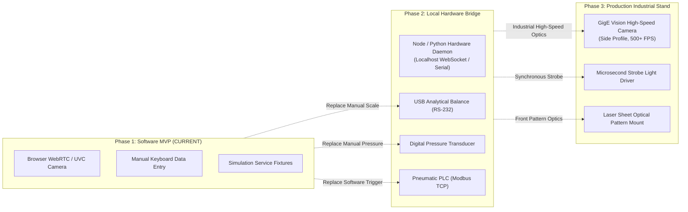
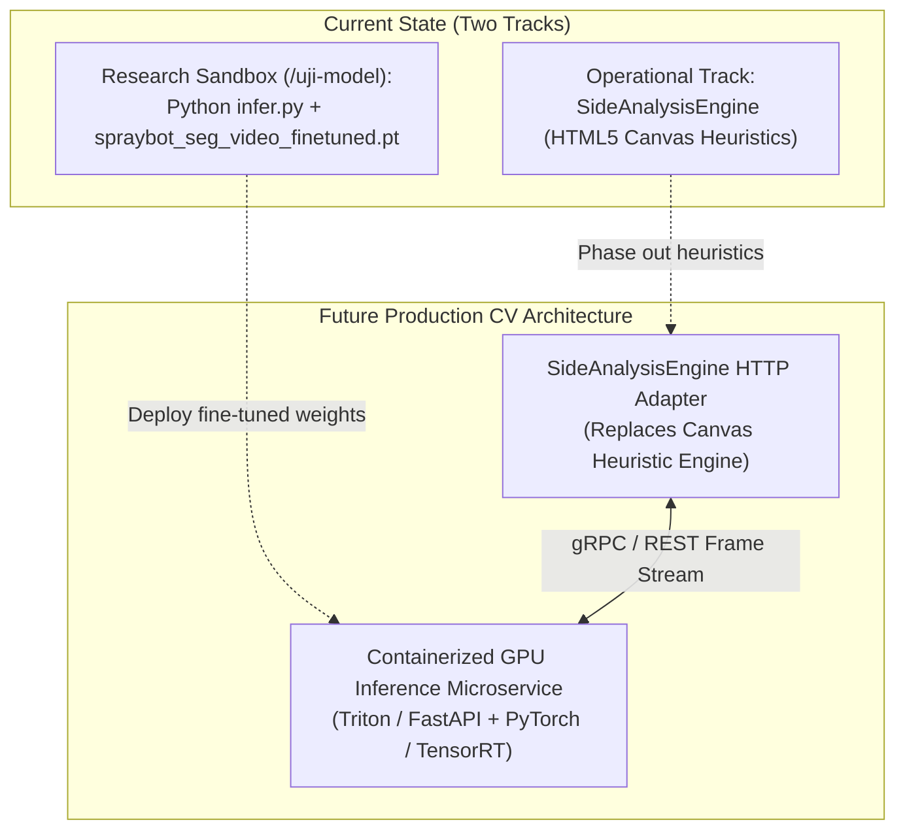

# OPEN ITEMS AND ROADMAP — Pending Requirements, Integrations & Debt

```text
Status: Current Handover Reference
Last verified against: 29ad46a
Repository: C:\Users\user\Nata\Project\Spray-paragon\website
GitHub: RahmatHadinata23758051/Spray-Website
```

This document catalogs open technical questions, pending client business decisions, hardware integration roadmaps, and known technical debt for the **Spraybot** project.

---

## 1. Unresolved Client Requirements (Paragon R&D)

The following items require formal clarification and sign-off from the Packaging R&D leadership at PT Paragon Technology and Innovation:

### A. Stroke Depth Measurement Convention & Units
- **Current State**: The UI accepts "Kedalaman Stroke" as a floating-point number in millimeters (`mm`) in both setpoints (`setpoints.strokeMm`) and physical measurements (`actualStrokeDepth`).
- **Open Question**: Pneumatic actuators frequently measure displacement via rotary optical encoders reporting pulses, percentage of travel, or cylinder displacement rather than true actuator depression depth. 
- **Action Needed**: Finalize whether the machine firmware will report true linear millimeter travel or whether the software must maintain a calibration conversion curve ($mm = \text{pulses} \times k$).

### B. Sample Replication Semantics & Statistical Thresholds
- **Current State**: The system allows arbitrary repetitions (`repetitionIndex: 1, 2, ... N`) per sample. A sample is marked `TESTED` as soon as *one* test run is finalized.
- **Open Question**: Standard ASTM/ISO aerosol testing protocols typically mandate a minimum number of consecutive repetitions (e.g. 3 or 5 actuations per bottle) to calculate mean discharge rates and standard deviations.
- **Action Needed**: Determine whether `canFinalizeTestRun` or `KodePengujian` completion should enforce a mandatory replication threshold before allowing a study to transition to `CLOSED`.

### C. Droplet Size Distribution (D10, D50, D90)
- **Current State**: "Distribusi droplet" is available as an observation objective checkbox in Step 03, but no quantitative droplet sizing algorithm is currently executed on video frames.
- **Open Question**: Measuring microscopic aerosol droplet distributions (D10, D50, D90 in $\mu m$) accurately requires laser diffraction systems (e.g., Malvern Spraytec) or ultra-high-speed macro optics ($> 5000\text{ FPS}$). A standard 60 FPS USB camera cannot resolve individual $30\,\mu m$ mist droplets.
- **Action Needed**: Clarify whether "Distribusi droplet" in Spraybot is intended as a qualitative visual rating (Uniform / Clumped / Spattering) or whether Spraybot will import quantitative CSV data from a physical Malvern Spraytec analyzer.

### D. Official Corporate PDF Report Certificate
- **Current State**: CSV export is fully implemented (`createFinalReportCsv`). Printable browser preview styles (`@media print`) exist on `/reports`.
- **Open Question**: Paragon R&D requires a formal corporate certificate layout with specific header logos, regulatory disclaimers, and a 3-tier approval signature block (*Tested By Operator*, *Reviewed By Packaging Engineer*, *Approved By R&D Manager*).
- **Action Needed**: Obtain the signed PDF template specification from Paragon's Quality Assurance committee to build the server-side PDF generation service (e.g. via Puppeteer or `@react-pdf/renderer`).

---

## 2. Pending Hardware Integrations

The software currently operates in **Simulation Mode** or **Browser UVC Camera Mode** because physical machine hardware is currently under fabrication:



1. **Pneumatic Actuator & PLC**:
   - Connection via Modbus TCP (over Ethernet) or Serial RS-485.
   - The hardware bridge will listen for "Mulai Pengujian" from Spraybot, trigger the pneumatic solenoid valve, and stream back real-time load cell force ($N$) and encoder position ($mm$).
2. **Industrial High-Speed Camera & Strobe**:
   - Upgrading from a 60 FPS USB camera to a GigE Vision camera capable of 200–500 FPS.
   - Synchronous hardware pulse: The PLC must fire an optical trigger signal to synchronize the camera shutter and LED strobe light with the moment of nozzle depression.
3. **Physical Front Camera Optical Rig**:
   - Front camera analysis is currently 100% simulated because no front optical mount exists on the prototype test stand. Building a physical front mirror box or laser sheet mount is required before real front pattern capture can be implemented.

---

## 3. Pending Computer Vision Production Pipeline

Spraybot currently utilizes browser Canvas heuristics for operational analysis, alongside an experimental Model Testing Sandbox (`/uji-model`):



### Action Items for CV Migration
1. **Optimize YOLO Model**: Convert `spraybot_seg_video_finetuned.pt` to **TensorRT** or **ONNX** format for sub-10ms inference per frame on local GPU hardware.
2. **Containerize Inference Worker**: Package the Python runner into a Docker microservice exposing a REST/gRPC endpoint (`/predict-plume`).
3. **Swap `SideAnalysisEngine` Adapter**: Implement a remote adapter in `apps/web/src/data/remote/` that satisfies the `SideAnalysisEngine` port by calling the inference microservice, requiring zero changes to UI components.

---

## 4. Pending UX & Product Master Decisions

1. **Central Master Product Integration**:
   - **Current State**: Products are selected from local presets (`apps/web/src/data/local/productRepository.ts`) or entered as ad-hoc strings in Step 01.
   - **Roadmap**: Integrate with Paragon's central SAP/PLM product formulation registry via an enterprise REST API to pull official product codes, lot numbers, and nominal recipe thresholds automatically.
2. **Calibration Workflow Placement**:
   - **Current State**: Optical calibration resides on a separate administrative page (`/calibration`).
   - **Roadmap**: Evaluate whether camera pixel-to-millimeter calibration should be integrated as an optional pre-flight verification card in Wizard Step 04 before launching camera capture.

---

## 5. Technical Debt & Maintenance Tasks

| Priority | Component | Issue Description | Proposed Remediation |
|----------|-----------|-------------------|----------------------|
| **Medium** | Legacy Batch Model | `Batch` domain structures in `packages/domain/src/batch/` co-exist with `KodePengujian` to support historical test migration. | Once legacy database migrations are confirmed in production, deprecate `batchRepository.ts` and remove legacy adapters. |
| **Medium** | Component Splitting | `TestRunCapturePage.tsx` and `TestExecutionWizardPage.tsx` have grown large due to state-machine handling. | Refactor local states into dedicated custom hooks (`useWizardState`, `useCameraCaptureSession`). |
| **Low** | Media Upload Streaming | Currently, media manifests are registered during sync, but raw binary upload URLs are mocked. | Implement multipart background chunk uploading to an S3-compatible object store (e.g. MinIO or AWS S3). |
| **Low** | Dependency Upgrades | Vitest and Drizzle dev tools have minor transitive dev-dependency warnings. | Plan scheduled major version upgrades when Vitest 5 and Drizzle-kit 0.20+ reach long-term stability. |
