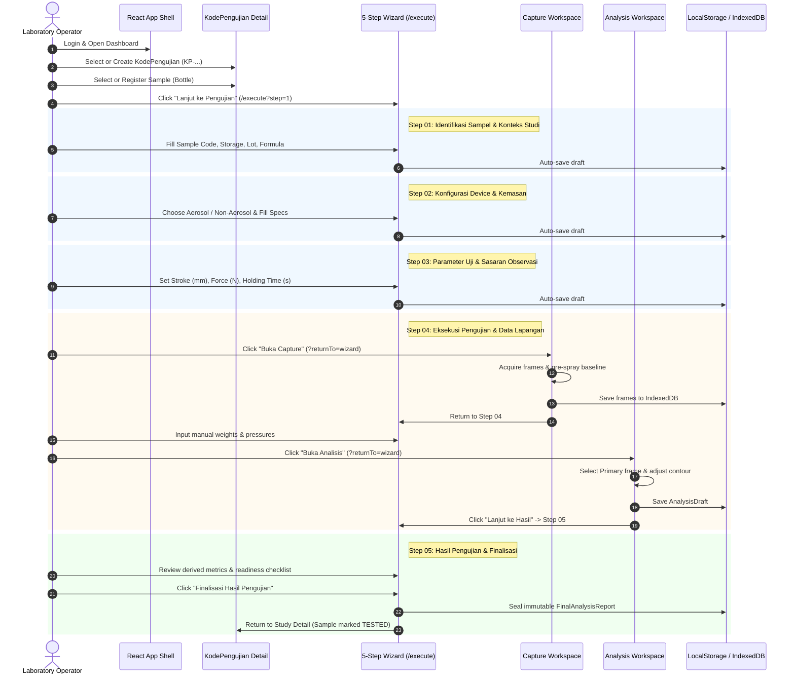
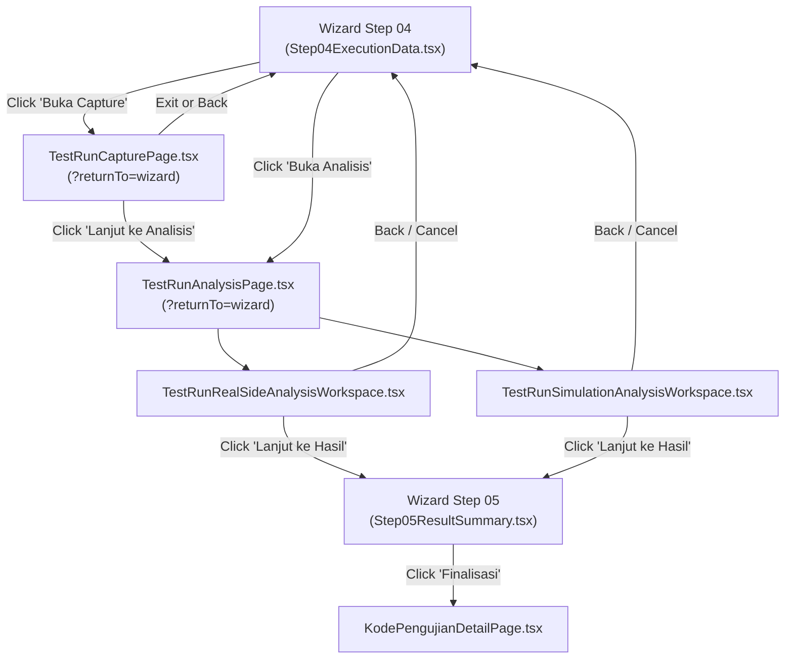

# OPERATOR WORKFLOW — The 5-Step Operational Testing Wizard

```text
Status: Current Handover Reference
Last verified against: 29ad46a
Repository: C:\Users\user\Nata\Project\Spray-paragon\website
GitHub: RahmatHadinata23758051/Spray-Website
```

This document specifies the human operator journey, the client-aligned 5-step testing wizard, sub-workspace navigation contracts, and the strict distinction between active test review (Step 05) and historical reporting (`/result`).

---

## 1. High-Level Operator Testing Journey

The typical laboratory workflow for a packaging engineer or laboratory operator proceeds as follows:



---

## 2. The Canonical 5-Step Testing Wizard

The active test execution screen is rendered by `TestExecutionWizardPage.tsx` at route:
`/kode-pengujian/:kpId/samples/:sampleId/runs/:runId/execute`

The wizard strictly adheres to the 5 numbered stages established by Paragon R&D:

```text
┌─────────────────┐   ┌─────────────────┐   ┌─────────────────┐   ┌─────────────────┐   ┌─────────────────┐
│ 01. Identifikasi│──>│   02. Device    │──>│  03. Parameter  │──>│  04. Eksekusi   │──>│   05. Hasil     │
│ Sample & Study  │   │ Aerosol / Pump  │   │ Machine & Target│   │ Capture & Meas. │   │ Finalize Report │
└─────────────────┘   └─────────────────┘   └─────────────────┘   └─────────────────┘   └─────────────────┘
```

### Step 01: Identifikasi Sampel & Konteks Studi (`Step01Identification.tsx`)
- **Job of the Page**: Identify the physical test unit and anchor it to the formulation research context.
- **Fields**:
  - Sample Code (`sampleCode`, e.g., `SMP-A1`).
  - Position in Run (`positionInRun`, e.g., `1`).
  - Storage Condition (`storageCondition`, e.g., `Ruang`, `Oven 40`, `Siklus`).
  - Storage Position (`bottlePosition`, e.g., `Tegak`, `Tidur`).
  - Formulation Number (`formulaNumber`, e.g., `F-BOD-0442`).
  - Product Lot (`lotNumber`, e.g., `LOT-2026-X1`).
  - KUF (`kuf`).
  - Trial Objective (`trialObjective`).
  - Benchmark Product (`benchmark`).
  - Trial Type (`trialType`: `Lab`, `PS`, `MP`).

### Step 02: Konfigurasi Device & Kemasan (`Step02DeviceConfig.tsx`)
- **Job of the Page**: Capture packaging and nozzle specifications.
- **Device Type Toggle**:
  - **Aerosol**: Actuator Code, Can/Bottle Code, Valve Code, Gas Ratio (%), Gas Type.
  - **Non-Aerosol**: Bottle Code, Pump Code.
- **Usage Pattern**: `Sekali Pakai` vs `Berulang`.

### Step 03: Parameter Uji & Sasaran Observasi (`Step03Parameters.tsx`)
- **Job of the Page**: Define machine actuator setpoints and testing evaluation goals.
- **Machine Setpoints**:
  - Stroke Depth (`strokeMm`, e.g., `10 mm`).
  - Force Setpoint (`forceSetpointN`, e.g., `25 N`).
  - Force Mode (`Normal` vs `Tidak Normal`).
  - Holding Time (`holdingTimeS`, converted to `pressDurationMs`).
  - Bottle Height (`bottleHeightMm`) & Actuator Area (`actuatorAreaMm2`).
- **Observation Objectives**: Checkboxes for targeted evaluation criteria:
  - `Panjang lintasan`
  - `Sebaran`
  - `Sudut kontak`
  - `Kecepatan pengeringan`
  - `Distribusi droplet`

### Step 04: Eksekusi Pengujian & Data Lapangan (`Step04ExecutionData.tsx`)
- **Job of the Page**: Bridge automated hardware capture with physical bench measurements.
- **Sub-Panels**:
  1. **Capture Kamera Card**: Displays capture status (`Belum ada data` vs `Selesai (N frame)`) and the primary action button (`Buka Capture` / `Ulangi Capture`).
  2. **Data Aktual Mesin & Fisik**:
     - Initial & Final Gross Weight (`initialGrossWeightG`, `finalGrossWeightG`).
     - Initial & Final Pressure (`initialPressureBar`, `finalPressureBar`) *(Aerosols only)*.
     - Actual Stroke Depth (`actualStrokeDepth`) & Press Duration (`actualPressDurationS`).
     - Leakage Status (`leakage`: `Tidak` / `Ya`).
     - Drying Time (`dryingTimeS`) & Observation Notes (`observationNotes`).
  3. **Live Operational Metrics Banner**: Instantly calculates and displays:
     - **Massa Semprot**: $\Delta m = m_{\text{initial}} - m_{\text{final}}$
     - **Laju Keluaran**: $R = \Delta m / t_{\text{actual}}$
     - **Penurunan Tekanan**: $\Delta P = P_{\text{initial}} - P_{\text{final}}$
  4. **Analisis Kamera Card**: Displays analysis status (`Menunggu capture`, `Belum selesai`, or `Selesai`) and launches the analysis workspace (`Buka Analisis` / `Tinjau Analisis`).

### Step 05: Hasil Pengujian & Finalisasi (`Step05ResultSummary.tsx`)
- **Job of the Page**: Review comprehensive physical and visual results, verify finalization readiness, and permanently seal the test run.
- **Panels**:
  - Final operational metrics table.
  - Visual measurement evidence cards (spray angle, plume width, spray height).
  - Primary evidence frame preview.
  - **Readiness Verification Checklist** (`canFinalizeTestRun`):
    - [x] Capture session completed.
    - [x] Computer vision analysis draft generated.
    - [x] Primary evidence capture selected.
    - [x] Physical gross weights and duration recorded.
  - **Action**: "Finalisasi Hasil Pengujian" button. Once clicked, the test run is sealed permanently.

---

## 3. Step 04 Sub-Workspaces & Navigation Return Contract

A fundamental architecture rule of Spraybot is that **Capture and Analysis are sub-workspaces of Step 04**, not top-level wizard steps:



### Navigation Rules
1. **Preserving Return Context**: When launching capture or analysis from the wizard, the route query parameter `?returnTo=wizard` is appended.
2. **Exiting Capture**: Exiting `TestRunCapturePage` returns the operator directly to `execute?step=4`.
3. **Completing Analysis**: Completing analysis in `TestRunRealSideAnalysisWorkspace` or `TestRunSimulationAnalysisWorkspace` returns the operator directly to **Wizard Step 05** (`execute?step=5`).
4. **Never Return to `/result` during Active Flow**: Sub-workspaces must never route an active unfinalized test run to `/result`.

---

## 4. Distinction Between Wizard Step 05 and `/result`

Incoming developers often confuse Wizard Step 05 with the `/result` page. They serve completely different roles:

| Dimension | Wizard Step 05 (`Step05ResultSummary.tsx`) | Result Page (`TestRunResultPage.tsx`) |
|-----------|--------------------------------------------|---------------------------------------|
| **Primary Route** | `/kode-pengujian/:kpId/samples/:sampleId/runs/:runId/execute?step=5` | `/kode-pengujian/:kpId/samples/:sampleId/runs/:runId/result` |
| **Workflow Stage** | **Active testing phase** (pre-finalization). | **Historical inspection phase** (post-finalization). |
| **Status Gating** | Accessible while `TestRun` is `ANALYZING` or `REVIEW_REQUIRED`. | Strictly displays finalized data. If unfinalized, renders warning panel. |
| **Actions Allowed** | Review draft metrics, verify checklist, trigger **Finalize**. | Read-only inspection, toggle technical disclosures, **Download CSV**. |
| **Editable Context** | Operator can navigate back to Steps 1–4 to adjust data. | Entirely read-only; no backward navigation to wizard. |
| **Access Origin** | Reached naturally by progressing through the 5-step wizard. | Reached from table rows in `KodePengujianDetailPage` or `/reports`. |

---

## 5. Client Form Field Reference Table

This reference maps every client specification field to its internal domain representation:

| Client Form Field | UI Input Type | Domain Property | Storage Table & Column |
|-------------------|---------------|-----------------|------------------------|
| **Kode Pengujian** | Text / Auto-generated | `KodePengujian.id` | `kode_pengujian.id` |
| **Nama / Kode Produk** | Select dropdown | `KodePengujian.productId` | `kode_pengujian.product_id` |
| **No. Lot** | Text input | `KodePengujian.productLot` | `kode_pengujian.product_lot` |
| **No. Formula** | Text input | `KodePengujian.formulaNumber` | `kode_pengujian.metadata.formulaNumber` |
| **Periode Pengujian** | Text input | `KodePengujian.testPeriod` | `kode_pengujian.test_period` |
| **Kondisi Penyimpanan** | Select dropdown | `storageCondition` | `kode_pengujian.storage_condition` / `samples.storage_condition` |
| **Posisi Botol** | Select dropdown | `bottlePosition` | `kode_pengujian.bottle_position` / `samples.bottle_position` |
| **Kode Sampel** | Text input | `Sample.sampleCode` | `samples.sample_code` |
| **Posisi Running** | Number input | `Sample.positionInRun` | `samples.position_in_run` |
| **Tipe Device** | Toggle (Aerosol / Non-Aerosol) | `deviceConfiguration.deviceType` | `samples.metadata.deviceConfiguration` |
| **Kode Actuator / Pump** | Text input | `deviceConfiguration.*.actuatorCode` | `samples.metadata.deviceConfiguration` |
| **Pola Penggunaan** | Select (Sekali Pakai / Berulang) | `Sample.usagePattern` | `samples.metadata.usagePattern` |
| **Kedalaman Stroke (mm)** | Number input | `setpoints.strokeMm` | `test_runs.setpoints.strokeMm` |
| **Gaya Penekanan (N)** | Number input | `setpoints.forceSetpointN` | `test_runs.setpoints.forceSetpointN` |
| **Holding Time (s)** | Number input | `setpoints.pressDurationMs` | `test_runs.setpoints.pressDurationMs` |
| **Berat Kotor Awal (g)** | Number input | `executionMeasurements.initialGrossWeightG` | `test_runs.execution_measurements` |
| **Berat Kotor Akhir (g)** | Number input | `executionMeasurements.finalGrossWeightG` | `test_runs.execution_measurements` |
| **Tekanan Awal (bar)** | Number input | `executionMeasurements.initialPressureBar` | `test_runs.execution_measurements` |
| **Tekanan Akhir (bar)** | Number input | `executionMeasurements.finalPressureBar` | `test_runs.execution_measurements` |
| **Status Kebocoran** | Select (Tidak / Ya) | `executionMeasurements.leakage` | `test_runs.execution_measurements` |
| **Waktu Pengeringan (s)** | Number input | `executionMeasurements.dryingTimeS` | `test_runs.execution_measurements` |
| **Massa Semprot (g)** | Auto-calculated | `operationalDerivedMetrics.dischargedMassG` | `test_runs.operational_derived_metrics` |
| **Laju Keluaran (g/s)** | Auto-calculated | `operationalDerivedMetrics.dischargeRateGPerS` | `test_runs.operational_derived_metrics` |
| **Penurunan Tekanan (bar)** | Auto-calculated | `operationalDerivedMetrics.pressureDropBar` | `test_runs.operational_derived_metrics` |
