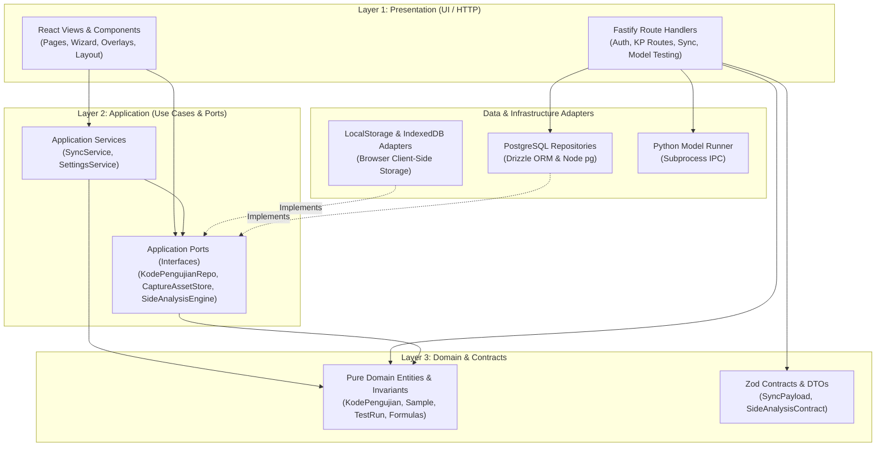
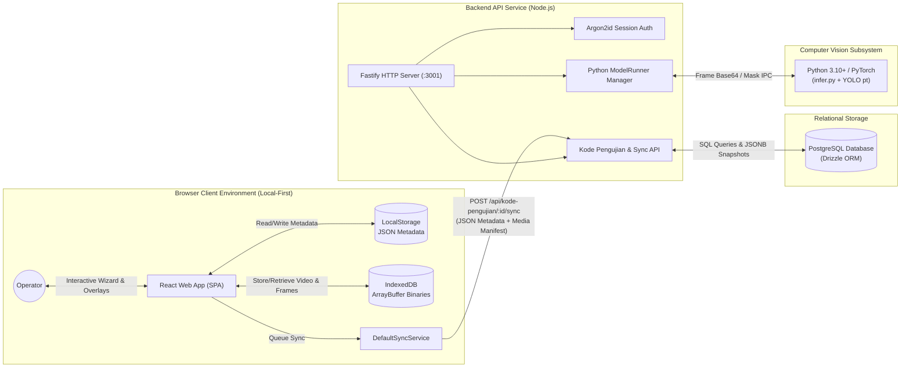
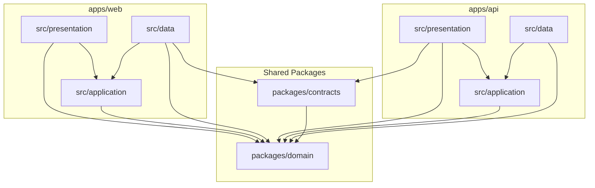
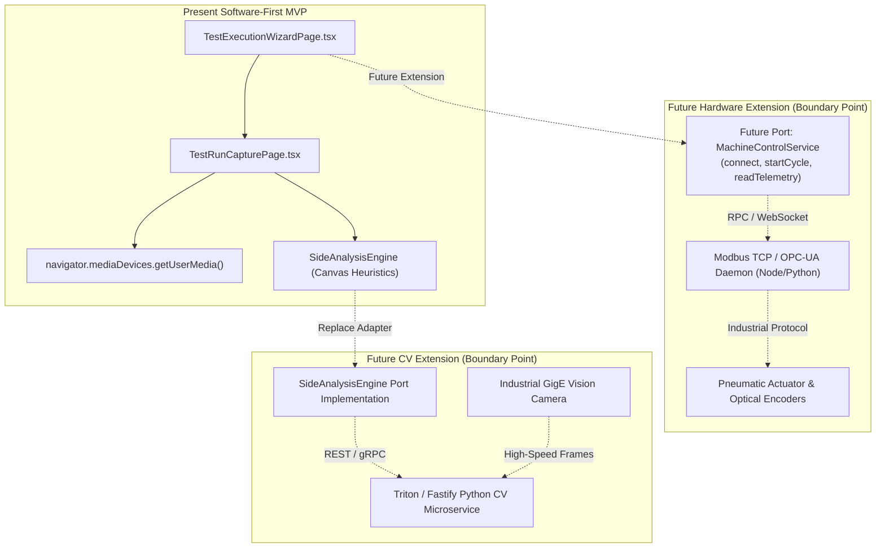

# SYSTEM ARCHITECTURE — Monorepo & Layered Architecture

```text
Status: Current Handover Reference
Last verified against: 29ad46a
Repository: C:\Users\user\Nata\Project\Spray-paragon\website
GitHub: RahmatHadinata23758051/Spray-Website
```

This document details the software architecture, package boundaries, layer separation, and dependency directions of the **Spraybot** repository.

---

## 1. Monorepo Organization

Spraybot is structured as a TypeScript npm workspaces monorepo:

```text
Spray-paragon/website/
├── apps/
│   ├── web/           # React 18 + Vite frontend application (@spray-paragon/web)
│   └── api/           # Fastify 5 + Drizzle ORM backend application (@spray-paragon/api)
├── packages/
│   ├── domain/        # Pure TypeScript business rules & calculations (@spray-paragon/domain)
│   └── contracts/     # Zod runtime validation schemas & DTOs (@spray-paragon/contracts)
├── models/
│   └── segmentation/  # YOLO plume segmentation weights & Python inference runner
├── docs/              # Developer handover documentation
└── e2e/               # Playwright browser end-to-end test suite
```

### Workspace Dependency Rules

1. **`packages/domain`**: The core domain model. It has **zero dependencies** on external libraries or frameworks (no React, no Fastify, no database drivers, no Zod). It defines pure TypeScript entities, calculation utilities, and invariant errors.
2. **`packages/contracts`**: Depends only on `zod` and `packages/domain`. It defines runtime validation schemas for API inputs, sync payloads, and external computer vision envelopes.
3. **`apps/api`**: Depends on `packages/domain` and `packages/contracts`. It imports Fastify, Drizzle ORM, and PostgreSQL drivers. It never imports from `apps/web`.
4. **`apps/web`**: Depends on `packages/domain` and `packages/contracts`. It imports React, Vite, and Tailwind CSS. It never imports server code or database drivers.

---

## 2. The 3-Tier Layered Architecture

Both applications strictly respect Hexagonal (Ports & Adapters) principles organized into three distinct layers:



### Layer 1 — Presentation
- **Web (`apps/web/src/presentation/`)**: Contains React components, routing (`App.tsx`), UI layouts (`AppShell.tsx`), forms, tables, timeline controls, canvas measurement overlays, and page views. Presentation components do not contain business logic or SQL queries.
- **API (`apps/api/src/presentation/`)**: Contains Fastify route plugins, cookie parsers, rate limiters, error serialization, and authentication hooks.

### Layer 2 — Application
- **Web Application (`apps/web/src/application/`)**: Defines use-case workflows and interface contracts ("Ports").
  - `ports/kodePengujianRepository.ts`: Abstract repository for test study aggregates.
  - `ports/captureAssetStore.ts`: Abstract binary store for media frames and video.
  - `ports/sideAnalysisEngine.ts`: Contract for computer vision contour processing.
  - `ports/sync.ts`: Remote synchronization orchestrator interfaces.
  - `sync/syncService.ts`: Concrete implementation coordinating local data, media manifests, and remote sync.

### Layer 3 — Domain & Contracts
- **`packages/domain`**: Business rules, state transition functions (`createKodePengujian`, `addSample`, `createTestRun`, `startTestRunCapture`, `finalizeTestRun`), and pure formulas (`calculateDischargedMass`, `calculateDischargeRate`, `calculatePressureDrop`).
- **`packages/contracts`**: Zod schemas guaranteeing that any data entering the domain across network or storage boundaries is strictly validated.

---

## 3. Overall System Architecture Diagram



---

## 4. Code Dependency & Boundary Rules

To ensure long-term maintainability and prevent structural decay, dependencies must flow strictly in one direction:



### Prohibited Cross-Boundary Patterns

- ❌ **NEVER import `apps/api` code into `apps/web`**: Webpack/Vite will fail to bundle Node.js built-ins (`crypto`, `fs`, `path`, `drizzle-orm/node-postgres`).
- ❌ **NEVER import `apps/web` code into `apps/api`**: Keeps the backend fully decoupled from React or browser DOM concepts.
- ❌ **NEVER import `drizzle-orm` or SQL drivers in `packages/domain`**: The domain is purely computational and framework-agnostic.
- ❌ **NEVER pass raw camera blobs directly to PostgreSQL**: Large binary payloads (megabytes of frame images or MP4 recordings) must never be injected into SQL columns or sync JSON payloads.

---

## 5. Ports and Adapters Specification

The application layer decouples UI and use-cases from infrastructure details via clean Ports:

### Key Ports in `apps/web/src/application/ports/`

| Port Interface | Primary Responsibility | Production Implementation | Testing / Fallback Mock |
|----------------|------------------------|---------------------------|-------------------------|
| `KodePengujianRepository` | CRUD and status operations for study aggregates | `LocalStorageKodePengujianRepository` | `MemoryKodePengujianRepository` |
| `CaptureAssetStore` | Persist, resolve, and delete high-volume frame/video binaries | `IndexedDbCaptureAssetStore` (`spraybot.capture-assets.v1`) | `MemoryCaptureAssetStore` |
| `SideAnalysisEngine` | Compute plume geometry (angles, widths, heights) from image frames | Browser Canvas Heuristic Engine | Synthetic Geometry Fixtures |
| `SimulationService` | Generate deterministic multi-camera frames for laboratory demonstrations | `SimulationServiceImpl` (4 deterministic scenarios) | Hardcoded frame fixtures |
| `SyncService` | Orchestrate background queueing, conflict detection, and server push | `DefaultSyncService` | No-op mock sync service |
| `KodePengujianRemoteRepository` | Network transport to Fastify backend | `HttpKodePengujianRemoteRepository` (Fetch API) | `MockKodePengujianRemoteRepository` |
| `CaptureMediaRemoteStore` | Register remote media descriptors | `MockCaptureMediaRemoteStore` | Memory manifest map |

---

## 6. Integration Boundaries for Future Extensions

The software architecture is deliberately built with clear extension points for future hardware and CV integrations:



1. **Physical Actuator Integration**: When physical machine hardware is built, an incoming engineer will create a `MachineControlService` interface in `apps/web/src/application/ports/` and wire it to a local WebSocket or serial bridge connecting to the PLC.
2. **Production Computer Vision**: The browser-side `SideAnalysisEngine` port can be swapped out for an HTTP adapter calling a dedicated GPU inference service running Triton or FastAPI, without touching any presentation component or domain entity.
