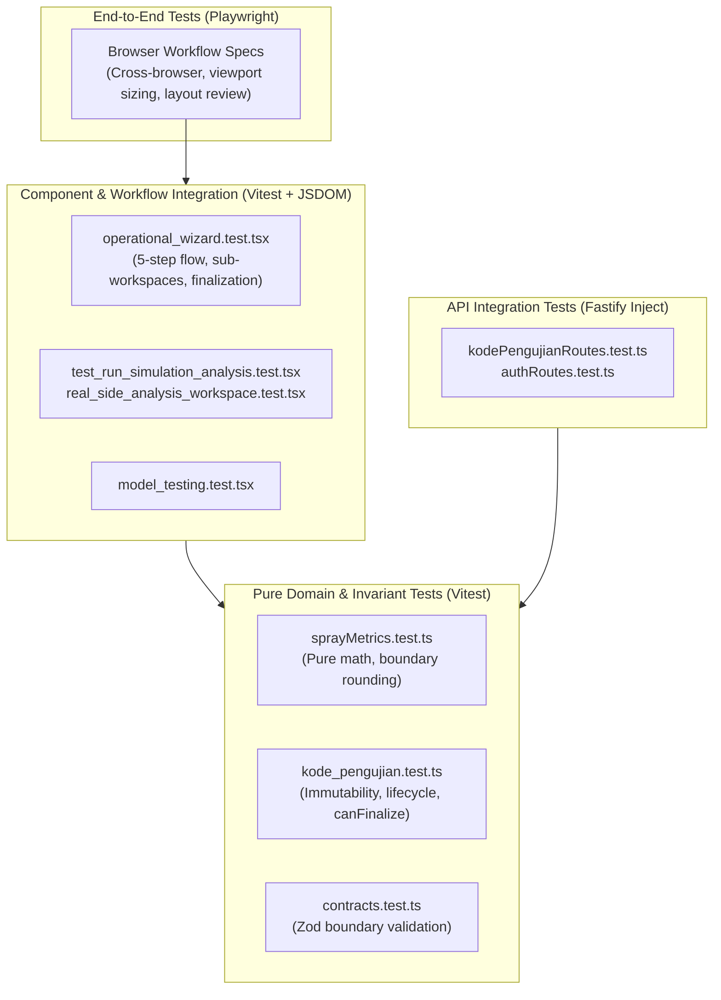

# TESTING AND QA — Test Strategy, Critical Suites & Protected Invariants

```text
Status: Current Handover Reference
Last verified against: 29ad46a
Repository: C:\Users\user\Nata\Project\Spray-paragon\website
GitHub: RahmatHadinata23758051/Spray-Website
```

This document details the testing philosophy, automated test suites, quality gates, and critical regression scenarios that protect the **Spraybot** codebase against behavioral regressions.

---

## 1. Testing Philosophy Across the Stack

Spraybot adopts a multi-tiered testing strategy where each layer is tested at its natural boundary:



1. **Domain Layer (Pure TypeScript)**: Zero-dependency, instantaneous unit tests verifying entity lifecycle transitions, mathematical rounding, and invariant exceptions.
2. **Contracts Layer (Zod)**: Ensures that API request and response contracts strictly reject invalid or malformed data before reaching the domain.
3. **Application & API Layer (Fastify Inject)**: Tests Fastify endpoints using in-memory mock repositories without requiring live PostgreSQL instances.
4. **Presentation Layer (React Testing Library + JSDOM)**: Simulates operator interactions, stepper navigation, draft auto-saving, canvas overlay rendering, and finalization locking.
5. **E2E Layer (Playwright)**: Verifies visual layouts, desktop (1440×900) vs mobile (390×844) responsive rendering, and complete user journeys.

---

## 2. Critical Regression Test Suites

The following test suites represent the core safety net of the application. They must **never** be skipped or allowed to fail:

### 1. Operational Wizard Suite (`apps/web/src/__tests__/operational_wizard.test.tsx`)
- **Coverage**: 25 comprehensive integration tests.
- **Key Scenarios Tested**:
  - Gating through Steps 1 to 5 via `evaluateWizardProgress()`.
  - Switching between Aerosol and Non-Aerosol device configurations.
  - Live metric computation in Step 04 (Discharged Mass, Discharge Rate, Pressure Drop).
  - Draft auto-saving and state restoration.
  - Sub-workspace return routing (`?returnTo=wizard` returning to Step 04/05).
  - Precondition validation via `canFinalizeTestRun()`.
  - Read-only lockdown upon finalization (disabling inputs, showing immutable status badges).

### 2. Simulation Analysis Workspace (`apps/web/src/__tests__/test_run_simulation_analysis.test.tsx`)
- **Coverage**: 18 integration tests.
- **Key Scenarios Tested**:
  - Timeline frame scrubbing and synchronous multi-camera playback.
  - Switching perspectives between Side Plume (Geometry) and Front Spray (Pattern).
  - Rendering view modes: `Original`, `Mask`, and `Overlay`.
  - Designating a frame as Primary Evidence (`primaryCaptureMomentId`).
  - Selecting supporting evidence frames (`supportingCaptureMomentIds`).
  - Returning directly to Wizard Step 05 (`execute?step=5`) upon analysis completion.

### 3. Real Side Camera Analysis (`apps/web/src/__tests__/real_side_analysis_workspace.test.tsx`)
- **Coverage**: 5 integration tests.
- **Key Scenarios Tested**:
  - Frame asset resolution from IndexedDB.
  - Pre-spray baseline background subtraction.
  - Real-time contour geometry extraction (cone angle, plume width, spray height).
  - Verification that Front camera options are disabled during real capture analysis.

### 4. Model Testing Sandbox (`apps/web/src/__tests__/model_testing.test.tsx`)
- **Coverage**: 2 integration tests.
- **Key Scenarios Tested**:
  - Video upload and frame extraction workflow.
  - Model testing wizard step progression (`Step01ModelIdent` to `Step05ModelResult`).
  - Subprocess inference fallback handling when Python environment is offline.

### 5. Domain Metrics & Invariants (`packages/domain/src/__tests__/`)
- `sprayMetrics.test.ts`: Verifies exact 3-decimal rounding for discharged mass, rate calculation division-by-zero protection, and aerosol-only pressure drop rules.
- `kode_pengujian.test.ts`: Tests `createKodePengujian`, `addSample`, `createTestRun`, `startTestRunCapture`, `finalizeTestRun`, and verifies that modifying finalized runs throws `DomainInvariantError`.

---

## 3. Invariants Protected by the Test Suite

| Invariant | Test Suite Enforcing It | How It Is Protected |
|-----------|-------------------------|---------------------|
| **Immutability of Finalized Results** | `kode_pengujian.test.ts`<br/>`operational_wizard.test.tsx` | Asserts that calling update functions on a finalized run throws `DomainInvariantError`. Verifies UI disables all form inputs. |
| **Pure Operational Calculation Authority** | `sprayMetrics.test.ts`<br/>`operational_wizard.test.tsx` | Asserts that `finalizeTestRun()` forcefully recomputes derived metrics from raw physical measurements, ignoring caller overrides. |
| **Sub-Workspace Return Paths** | `operational_wizard.test.tsx`<br/>`test_run_simulation_analysis.test.tsx` | Asserts that exiting capture navigates to `execute?step=4` and completing analysis navigates to `execute?step=5`. |
| **Finalization Readiness Gate** | `kode_pengujian.test.ts`<br/>`operational_wizard.test.tsx` | Asserts that `canFinalizeTestRun()` returns `false` with explicit reasons if primary capture, measurements, or drafts are missing. |
| **IndexedDB Binary Isolation** | `real_side_analysis_workspace.test.tsx` | Asserts that frame bytes are stored in IndexedDB and referenced via asset IDs, never loaded into the main aggregate record. |

---

## 4. Running Tests Quickly on Development Machines

Running the entire test suite across all workspaces simultaneously can take 30–45 seconds due to JSDOM environment initialization on Windows.

For fast, sub-second feedback during development, run targeted test files:

```bash
# Run the 5-step operational wizard tests
npx vitest run apps/web/src/__tests__/operational_wizard.test.tsx

# Run the simulation analysis workspace tests
npx vitest run apps/web/src/__tests__/test_run_simulation_analysis.test.tsx

# Run real Side camera analysis tests
npx vitest run apps/web/src/__tests__/real_side_analysis_workspace.test.tsx

# Run model testing sandbox tests
npx vitest run apps/web/src/__tests__/model_testing.test.tsx

# Run pure domain calculation and aggregate tests
npx vitest run packages/domain/src/__tests__/sprayMetrics.test.ts
npx vitest run packages/domain/src/__tests__/kode_pengujian.test.ts

# Run contract Zod validation tests
npx vitest run packages/contracts/src/__tests__/contracts.test.ts
```

---

## 5. End-to-End (E2E) Browser Testing with Playwright

Playwright is used to verify cross-browser rendering and layout integrity:

```bash
# Run all Playwright tests
npx playwright test

# Run Playwright in interactive UI mode
npx playwright test --ui

# Run viewport regression tests
npx playwright test e2e/workflow.spec.ts
```

Tests run against two canonical viewports to ensure responsive stability:
- **Desktop Primary**: $1440 \times 900$ (Standard laboratory bench monitor).
- **Mobile / Tablet**: $390 \times 844$ (Mobile QA and responsive collapse inspection).
